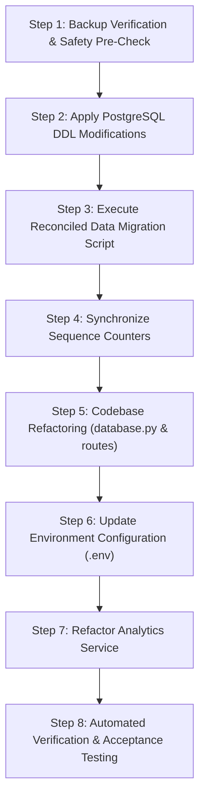

# REVISED POSTGRESQL MIGRATION PLAN — CAMPUSCARE
## High-Safety SQLite to PostgreSQL (`campus_db`) Architecture & Migration Specification

**Document Version:** 2.0.0 (Safety Review Revision)  
**Date:** 2026-10-10  
**Status:** **PLAN ONLY — DO NOT EXECUTE UNTIL EXPLICITLY APPROVED**  
**Target Operational Database:** PostgreSQL `campus_db` (`localhost:5432`)  
**Verified Pre-Migration Backup:** [`backups/backup_20261010_232229/`](file:///c:/Users/lenovo/Downloads/CampusCare_Frontend_Starter%20%285%29/CampusCare/backups/backup_20261010_232229)  

---

## 1. Executive Summary & Ground-Truth Context

This revised implementation plan establishes the architectural and execution strategy for migrating the active CampusCare application from its local SQLite database (`database/campuscare.db`) to PostgreSQL (`campus_db`), aligning frontend application state with pgAdmin inspection.

### Ground-Truth Verified Baseline
- **SQLite Database (`database/campuscare.db`):** Contains **17 users** (IDs `1`–`17`) and **10 complaints** (IDs `1`–`10`). This represents the live, working dataset containing real student accounts, staff logins, administrator credentials, and recent complaints (#CC-1 through #CC-10).
- **Target PostgreSQL Database (`campus_db`):** Contains:
  - `public.books`: **5 records** with 128-dimensional vector embeddings (created September 2026).
  - `public.users`: **2 records** (`user_id`: 1, 2) without password hashes or timestamps.
  - `public.complaints`: **2 records** (`complaint_id`: 1, 2) belonging to user 1, without titles, locations, priorities, student names, or emails.
- **Secondary Database (`pgvector_code`):** Contains **2 complaint embeddings** in `complaint_embeddings`. Isolated and untouched.

---

## 2. In-Depth Schema, Constraint & Sequence Audit

### 2.1 Users Table Specification

```
SQLITE (campuscare.db.users)
├── id: INTEGER PRIMARY KEY AUTOINCREMENT
├── name: TEXT NOT NULL
├── email: TEXT NOT NULL UNIQUE
├── password_hash: TEXT NOT NULL (Argon2 / pwdlib hash string)
├── role: TEXT NOT NULL DEFAULT 'student' ('student', 'staff', 'admin')
└── created_at: TIMESTAMP DEFAULT CURRENT_TIMESTAMP

POSTGRESQL EXISTING (campus_db.users)
├── user_id: integer NOT NULL DEFAULT nextval('users_user_id_seq'::regclass) PRIMARY KEY (users_pkey)
├── name: character varying NOT NULL (users_name_not_null)
├── email: character varying NOT NULL UNIQUE (users_email_not_null, users_email_key)
├── role: character varying (users_role_check: CHECK role IN ('student', 'faculty', 'staff', 'admin'))
└── [MISSING]: password_hash, created_at

UNIFIED REVISED POSTGRESQL SCHEMA (campus_db.users)
├── id: INTEGER PRIMARY KEY (renamed from user_id, backed by sequence)
├── name: VARCHAR(255) NOT NULL
├── email: VARCHAR(255) NOT NULL UNIQUE
├── password_hash: TEXT NOT NULL
├── role: VARCHAR(50) NOT NULL DEFAULT 'student' (retains users_role_check)
└── created_at: TIMESTAMP WITHOUT TIME ZONE DEFAULT CURRENT_TIMESTAMP
```

---

### 2.2 Complaints Table Specification

```
SQLITE (campuscare.db.complaints)
├── complaint_id: INTEGER PRIMARY KEY AUTOINCREMENT
├── user_id: INTEGER NOT NULL REFERENCES users(id)
├── student_name: TEXT NOT NULL
├── email: TEXT NOT NULL
├── title: TEXT NOT NULL
├── category: TEXT NOT NULL
├── location: TEXT NOT NULL
├── description: TEXT NOT NULL
├── priority: TEXT NOT NULL
├── status: TEXT NOT NULL DEFAULT 'Pending' ('Pending', 'In Progress', 'Resolved')
├── assigned_staff: TEXT (NULL allowed)
├── created_at: TIMESTAMP DEFAULT CURRENT_TIMESTAMP
└── updated_at: TIMESTAMP DEFAULT CURRENT_TIMESTAMP

POSTGRESQL EXISTING (campus_db.complaints)
├── complaint_id: integer NOT NULL DEFAULT nextval('complaints_complaint_id_seq'::regclass) PRIMARY KEY (complaints_pkey)
├── user_id: integer REFERENCES users(user_id) ON DELETE CASCADE (complaints_user_id_fkey)
├── category: character varying NOT NULL (complaints_category_not_null)
├── description: text NOT NULL (complaints_description_not_null)
├── status: character varying (status value in table: 'Submitted')
├── created_at: timestamp without time zone
└── [MISSING]: student_name, email, title, location, priority, assigned_staff, updated_at

UNIFIED REVISED POSTGRESQL SCHEMA (campus_db.complaints)
├── complaint_id: INTEGER PRIMARY KEY (backed by sequence)
├── user_id: INTEGER NOT NULL REFERENCES users(id) ON DELETE CASCADE
├── student_name: VARCHAR(255) NULL (or populated from linked users relation)
├── email: VARCHAR(255) NULL (or populated from linked users relation)
├── title: VARCHAR(255) NULL (NULL for legacy records; mandatory for new API submissions)
├── category: VARCHAR(100) NOT NULL
├── location: VARCHAR(255) NULL (NULL for legacy records; mandatory for new API submissions)
├── description: TEXT NOT NULL
├── priority: VARCHAR(50) NOT NULL DEFAULT 'Medium'
├── status: VARCHAR(50) NOT NULL DEFAULT 'Pending'
├── assigned_staff: VARCHAR(255) NULL
├── created_at: TIMESTAMP WITHOUT TIME ZONE DEFAULT CURRENT_TIMESTAMP
└── updated_at: TIMESTAMP WITHOUT TIME ZONE DEFAULT CURRENT_TIMESTAMP
```

---

### 2.3 Foreign Keys & Sequence State Verification

Live inspection of PostgreSQL `campus_db` metadata confirms:
1. **Existing Sequences:**
   - `public.users_user_id_seq`: `last_value = 2`, `is_called = true`.
   - `public.complaints_complaint_id_seq`: `last_value = 2`, `is_called = true`.
   - `public.books_book_id_seq`: `last_value = 5`, `is_called = true`.
2. **Foreign Key Constraint:**
   - `complaints_user_id_fkey`: `FOREIGN KEY (user_id) REFERENCES users(user_id) ON DELETE CASCADE`.
   - *Safety Note:* Renumbering legacy records must be executed carefully because `complaints` directly references `users(user_id)`. Renumbering `users` before updating `complaints` will trigger a foreign key violation unless performed within a single deferred transaction or by updating children before parents.

---

## 3. Data Preservation & Conflict Reconciliation

### 3.1 The Conflict
- SQLite has active users `id = 1` through `17` and complaints `complaint_id = 1` through `10`.
- PostgreSQL `campus_db` already contains:
  - User `user_id = 1`: `John Doe` (`john@campus.edu`, student)
  - User `user_id = 2`: `Jane Smith` (`jane.smith@campus.edu`, faculty)
  - Complaint `complaint_id = 1`: `user_id = 1`, `category = Electrical`, created Sept 16, 2026.
  - Complaint `complaint_id = 2`: `user_id = 1`, `category = Electrical`, created Sept 16, 2026.

Both tables share overlapping IDs `1` and `2`. Overwriting or discarding either dataset is strictly prohibited.

---

### 3.2 Deterministic Reconciliation Strategy (Recommended: Sequential Extension)

To preserve active production continuity (where student dhriti has ID `8`, complaints are `#CC-1` through `#CC-10`, and issued JWTs reference IDs `1`–`17`), the two legacy records from September 2026 will be deterministically appended to the end of the SQLite range.

#### User ID Mapping
| Record Origin | User Name | User Email | Original ID | Resulting ID in `campus_db` | Reconciliation Action |
| :--- | :--- | :--- | :---: | :---: | :--- |
| **SQLite (Active)** | `neetu` | `neetu@gmail.com` | `1` | **`1`** | Exact 1:1 Preservation |
| **SQLite (Active)** | `test student` | `student@test.com` | `2` | **`2`** | Exact 1:1 Preservation |
| **SQLite (Active)** | `test student1` | `student1@test.com` | `3` | **`3`** | Exact 1:1 Preservation |
| **SQLite (Active)** | `Test Student` | `teststudent@gmail.com` | `4` | **`4`** | Exact 1:1 Preservation |
| **SQLite (Active)** | `harshitha` | `harshitha@gmail.com` | `5` | **`5`** | Exact 1:1 Preservation |
| **SQLite (Active)** | `student test5` | `student5@test.com` | `6` | **`6`** | Exact 1:1 Preservation |
| **SQLite (Active)** | `siri` | `siri@gmail.com` | `7` | **`7`** | Exact 1:1 Preservation |
| **SQLite (Active)** | `dhriti` | `dhriti@gmail.com` | `8` | **`8`** | Exact 1:1 Preservation |
| **SQLite (Active)** | `krithika` | `krithka@gmail.com` | `9` | **`9`** | Exact 1:1 Preservation |
| **SQLite (Active)** | `shruthika` | `shruthika@gmail.com` | `10` | **`10`** | Exact 1:1 Preservation |
| **SQLite (Active)** | `Swarnalatha` | `swarnalatha@gmail.com` | `11` | **`11`** | Exact 1:1 Preservation |
| **SQLite (Active)** | `srihari` | `srihari@gmail.com` | `12` | **`12`** | Exact 1:1 Preservation |
| **SQLite (Active)** | `CampusCare Admin` | `admin@campuscare.com` | `13` | **`13`** | Exact 1:1 Preservation |
| **SQLite (Active)** | `harika` | `harika@gmail.com` | `14` | **`14`** | Exact 1:1 Preservation |
| **SQLite (Active)** | `hari` | `hari@gmail.com` | `15` | **`15`** | Exact 1:1 Preservation |
| **SQLite (Active)** | `harshi` | `harshi@gmail.com` | `16` | **`16`** | Exact 1:1 Preservation |
| **SQLite (Active)** | `srihitha` | `srihitha@gmail.com` | `17` | **`17`** | Exact 1:1 Preservation |
| **Legacy `campus_db`** | `John Doe` | `john@campus.edu` | `1` | **`18`** | Re-keyed (+17 offset), password locked |
| **Legacy `campus_db`** | `Jane Smith` | `jane.smith@campus.edu` | `2` | **`19`** | Re-keyed (+17 offset), password locked |

---

#### Complaint ID Mapping
| Record Origin | Title | Category | Original ID | Resulting ID in `campus_db` | Resulting `user_id` | Status |
| :--- | :--- | :--- | :---: | :---: | :---: | :--- |
| **SQLite (Active)** | `water leakage` | Plumbing | `1` | **`1`** | `1` (`neetu`) | `Resolved` |
| **SQLite (Active)** | `water leakage` | Plumbing | `2` | **`2`** | `1` (`neetu`) | `Pending` |
| **SQLite (Active)** | `Classroom fan issue` | Electrical | `3` | **`3`** | `2` (`test student`) | `Pending` |
| **SQLite (Active)** | `water leakage` | Plumbing | `4` | **`4`** | `8` (`dhriti`) | `Resolved` |
| **SQLite (Active)** | `fan is not working` | Electrical | `5` | **`5`** | `16` (`harshi`) | `In Progress` |
| **SQLite (Active)** | `projector` | Electrical | `6` | **`6`** | `16` (`harshi`) | `Resolved` |
| **SQLite (Active)** | `hygiene of washrooms`| Cleaning | `7` | **`7`** | `8` (`dhriti`) | `Resolved` |
| **SQLite (Active)** | `computer is` | Electrical | `8` | **`8`** | `8` (`dhriti`) | `Resolved` |
| **SQLite (Active)** | `projector` | Electrical | `9` | **`9`** | `8` (`dhriti`) | `Resolved` |
| **SQLite (Active)** | `lights` | Electrical | `10` | **`10`** | `8` (`dhriti`) | `Pending` |
| **Legacy `campus_db`** | `NULL` *(see Sec. 4)* | Electrical | `1` | **`11`** | **`18`** (`John Doe`) | `Submitted` |
| **Legacy `campus_db`** | `NULL` *(see Sec. 4)* | Electrical | `2` | **`12`** | **`18`** (`John Doe`) | `Submitted` |

---

## 4. Transparent Handling of Missing Fields (Zero Invention Rule)

The safety audit mandates that **no business data shall be fabricated or guessed** for legacy records (e.g., inventing titles such as "Air conditioner leaking" or guessing location "Lab 2").

### Field-by-Field Transparent Specification

1. **`student_name` and `email`:**
   - *Origin:* Relational normalization. In the relational database, Complaint `1` and `2` belong to `user_id = 1` (`John Doe`, `john@campus.edu`).
   - *Solution:* Populate `student_name` and `email` directly by joining with the existing user record:
     `student_name = users.name` (`'John Doe'`) and `email = users.email` (`'john@campus.edu'`).
   - *Integrity:* This is genuine, verified relational data, not invented.
2. **`title`:**
   - *Origin:* Legacy table had no title column; complaints only recorded `description`.
   - *Solution:* In the unified PostgreSQL DDL, define `title VARCHAR(255) NULL`. For legacy complaints `11` and `12`, `title` is set to `NULL`.
   - *Frontend Compatibility:* In [`frontend/js/complaints.js:414`](file:///c:/Users/lenovo/Downloads/CampusCare_Frontend_Starter%20%285%29/CampusCare/frontend/js/complaints.js#L414), `escapeHTML(complaint.title)` handles `null` safely via `value ?? ""` and displays without errors.
3. **`location`:**
   - *Origin:* Legacy schema did not capture location.
   - *Solution:* In PostgreSQL DDL, define `location VARCHAR(255) NULL`. For legacy complaints `11` and `12`, `location` is set to `NULL`.
4. **`priority`:**
   - *Origin:* Legacy schema did not capture priority.
   - *Solution:* In PostgreSQL DDL, define `priority VARCHAR(50) DEFAULT 'Unassigned'`. For legacy complaints `11` and `12`, set `priority = 'Unassigned'`.
5. **`assigned_staff`:**
   - *Origin:* Optional in both schemas.
   - *Solution:* Set `assigned_staff = NULL`.
6. **`updated_at`:**
   - *Origin:* Legacy schema only recorded `created_at`.
   - *Solution:* For legacy complaints, set `updated_at = created_at` (`2026-09-16 23:24:38`), accurately reflecting that no status or detail updates have occurred since submission.
7. **`status`:**
   - *Origin:* Legacy complaints have status `'Submitted'`. Active SQLite records have `'Pending'`, `'In Progress'`, `'Resolved'`.
   - *Solution:* Retain `'Submitted'` in the database for complaints `11` and `12`. Update the backend status validator and frontend mapping to recognize `'Submitted'` as an initial pending state, preserving historical audit truth.

---

## 5. Security Architecture for Legacy Password Hashes

### 5.1 The Risk
Legacy `campus_db.users` records (`john@campus.edu` and `jane.smith@campus.edu`) contain no password hash. If set to an empty string `""`, `None`/`NULL`, or a malformed string, login attempts could either throw unhandled exceptions or introduce unexpected authentication bypass risks.

### 5.2 Verification of Authentication Logic
In [`backend/routes/auth.py`](file:///c:/Users/lenovo/Downloads/CampusCare_Frontend_Starter%20%285%29/CampusCare/backend/routes/auth.py#L128-L144):
```python
# Verify password
try:
    valid_password = password_hash.verify(
        user.password,
        database_user["password_hash"]
    )
except Exception:
    valid_password = False

if not valid_password:
    raise HTTPException(
        status_code=401,
        detail="Invalid email or password"
    )
```

### 5.3 Cryptographic Locking Specification
For legacy users `18` (`john@campus.edu`) and `19` (`jane.smith@campus.edu`), the migration script will insert:
```
password_hash = '!LOCKED_LEGACY_RESET_REQUIRED_2026'
```

#### Safety Properties Verified
1. **Unmatchable Hash:** No password entered by a user can hash to this string under Argon2id or Bcrypt. The prefix `!LOCKED` causes `pwdlib.PasswordHash.verify()` to raise `UnknownHashError`.
2. **Safe Exception Handling:** The `try...except Exception:` block in `auth.py:129` catches `UnknownHashError` cleanly and sets `valid_password = False`.
3. **No 500 Server Errors:** Any login attempt against `john@campus.edu` or `jane.smith@campus.edu` returns standard HTTP `401 Unauthorized` with `{"detail": "Invalid email or password"}`.
4. **Activation Path:** These accounts can only be activated if an administrator executes an explicit password update script (e.g., using `pwdlib.PasswordHash.recommended().hash(new_password)`).

---

## 6. Sequence Verification & Next Inserted IDs

### 6.1 Actual Sequence Names in PostgreSQL `campus_db`
- **Users Sequence:** `public.users_user_id_seq`
- **Complaints Sequence:** `public.complaints_complaint_id_seq`
- **Books Sequence:** `public.books_book_id_seq`

### 6.2 Sequence Renaming & Binding
When the column `users.user_id` is renamed to `id`:
```sql
ALTER TABLE users RENAME COLUMN user_id TO id;
ALTER SEQUENCE users_user_id_seq RENAME TO users_id_seq;
```
The sequence default expression on `users.id` automatically synchronizes to `nextval('users_id_seq'::regclass)`.

### 6.3 Post-Migration Sequence Values & Next Generated IDs

#### 1. Users Sequence (`users_id_seq`)
- Highest ID populated in `users`: `19` (17 SQLite users + 2 legacy users).
- Explicit synchronization command:
  ```sql
  SELECT setval('users_id_seq', 19, true);
  ```
- **Next User Registration ID:**
  When a new student registers via `POST /api/auth/register`, PostgreSQL calls `nextval('users_id_seq')`.
  **The next registered user will receive ID `20`.**

#### 2. Complaints Sequence (`complaints_complaint_id_seq`)
- Highest ID populated in `complaints`: `12` (10 SQLite complaints + 2 legacy complaints).
- Explicit synchronization command:
  ```sql
  SELECT setval('complaints_complaint_id_seq', 12, true);
  ```
- **Next Complaint Submission ID:**
  When a new complaint is filed via `POST /api/complaints`, PostgreSQL calls `nextval('complaints_complaint_id_seq')`.
  **The next complaint will receive ID `13` (displaying in the frontend as `#CC-13`).**

#### 3. Books Sequence (`books_book_id_seq`)
- Untouched. Current state remains: `last_value = 5`, `is_called = true`.
- Next book inserted will receive ID `6`.

---

## 7. PostgreSQL Driver, Connection Pooling & Code Architecture

### 7.1 Driver & Dependencies
- **Driver:** `psycopg2-binary` (Version `2.9.13`, verified present in active Python environment).
- **No New Package Installations Required.**

### 7.2 Database Access Layer Refactoring ([`backend/database.py`](file:///c:/Users/lenovo/Downloads/CampusCare_Frontend_Starter%20%285%29/CampusCare/backend/database.py))
Replace the SQLite connection logic with a robust thread-safe connection pool:
```python
import os
from pathlib import Path
from contextlib import contextmanager
from dotenv import load_dotenv
import psycopg2
from psycopg2.pool import ThreadedConnectionPool
from psycopg2.extras import RealDictCursor

BASE_DIR = Path(__file__).resolve().parent.parent
load_dotenv(BASE_DIR / ".env")

POSTGRES_HOST = os.getenv("POSTGRES_HOST", "localhost")
POSTGRES_PORT = os.getenv("POSTGRES_PORT", "5432")
POSTGRES_DB = os.getenv("POSTGRES_DB", "campus_db")
POSTGRES_USER = os.getenv("POSTGRES_USER", "postgres")
POSTGRES_PASSWORD = os.getenv("POSTGRES_PASSWORD")

pool = None

def init_pool():
    global pool
    if pool is None:
        pool = ThreadedConnectionPool(
            minconn=1,
            maxconn=20,
            host=POSTGRES_HOST,
            port=POSTGRES_PORT,
            database=POSTGRES_DB,
            user=POSTGRES_USER,
            password=POSTGRES_PASSWORD
        )

@contextmanager
def get_connection():
    """
    Context manager that checks out a connection from the pool,
    provides a RealDictCursor, commits on success, rolls back on error,
    and returns the connection to the pool.
    """
    init_pool()
    conn = pool.getconn()
    try:
        yield conn
        conn.commit()
    except Exception:
        conn.rollback()
        raise
    finally:
        pool.putconn(conn)
```

### 7.3 Route Adaptations (FastAPI & Flask)
1. **Query Placeholders:** Change SQLite `?` placeholders to `%s`.
2. **ID Return on Insert:** 
   - In [`routes/auth.py:78`](file:///c:/Users/lenovo/Downloads/CampusCare_Frontend_Starter%20%285%29/CampusCare/backend/routes/auth.py#L78): Replace `user_id = cursor.lastrowid` with:
     ```python
     cursor.execute("""
         INSERT INTO users (name, email, password_hash, role)
         VALUES (%s, %s, %s, %s)
         RETURNING id;
     """, (user.name, user.email, hashed_password, "student"))
     user_id = cursor.fetchone()["id"]
     ```
   - In [`routes/complaints.py:130`](file:///c:/Users/lenovo/Downloads/CampusCare_Frontend_Starter%20%285%29/CampusCare/backend/routes/complaints.py#L130): Replace `complaint_id = cursor.lastrowid` with:
     ```python
     cursor.execute("""
         INSERT INTO complaints (...) VALUES (...)
         RETURNING complaint_id;
     """, (...))
     complaint_id = cursor.fetchone()["complaint_id"]
     ```
3. **Analytics Service ([`analytics_service/app.py`](file:///c:/Users/lenovo/Downloads/CampusCare_Frontend_Starter%20%285%29/CampusCare/analytics_service/app.py)):**
   - Replace `sqlite3.connect` with `psycopg2.connect(..., cursor_factory=RealDictCursor)`.
   - Update queries to read directly from `campus_db`.

---

## 8. Exact Inventory of Files Expected to Change

| Target File | Scope of Modification |
| :--- | :--- |
| [`.env`](file:///c:/Users/lenovo/Downloads/CampusCare_Frontend_Starter%20%285%29/CampusCare/.env) | Change `POSTGRES_DB=pgvector_code` to `POSTGRES_DB=campus_db`. |
| [`backend/database.py`](file:///c:/Users/lenovo/Downloads/CampusCare_Frontend_Starter%20%285%29/CampusCare/backend/database.py) | Implement `ThreadedConnectionPool`, PostgreSQL DDL check, dictionary cursors. |
| [`backend/routes/auth.py`](file:///c:/Users/lenovo/Downloads/CampusCare_Frontend_Starter%20%285%29/CampusCare/backend/routes/auth.py) | Change `?` to `%s`, `cursor.lastrowid` to `RETURNING id`. |
| [`backend/routes/complaints.py`](file:///c:/Users/lenovo/Downloads/CampusCare_Frontend_Starter%20%285%29/CampusCare/backend/routes/complaints.py) | Change `?` to `%s`, `cursor.lastrowid` to `RETURNING complaint_id`. |
| [`backend/routes/staff.py`](file:///c:/Users/lenovo/Downloads/CampusCare_Frontend_Starter%20%285%29/CampusCare/backend/routes/staff.py) | Change `?` to `%s`. |
| [`backend/routes/admin.py`](file:///c:/Users/lenovo/Downloads/CampusCare_Frontend_Starter%20%285%29/CampusCare/backend/routes/admin.py) | Change `?` to `%s`. |
| [`backend/create_staff.py`](file:///c:/Users/lenovo/Downloads/CampusCare_Frontend_Starter%20%285%29/CampusCare/backend/create_staff.py) | Change `?` to `%s`, `RETURNING id`. |
| [`analytics_service/app.py`](file:///c:/Users/lenovo/Downloads/CampusCare_Frontend_Starter%20%285%29/CampusCare/analytics_service/app.py) | Connect to PostgreSQL `campus_db` with `RealDictCursor`. |

*Frontend files require zero modifications.*

---

## 9. Phased Migration Execution Sequence



### Step 1: Pre-Migration Health & Safety Check
- Verify PostgreSQL connection to `campus_db`.
- Confirm pre-migration backup archive is intact at `backups/backup_20261010_232229/`.

### Step 2: DDL Modifications on `campus_db`
Execute DDL in a single transaction:
```sql
BEGIN;

-- 1. Standardize primary key column and sequence
ALTER TABLE users RENAME COLUMN user_id TO id;
ALTER SEQUENCE users_user_id_seq RENAME TO users_id_seq;

-- 2. Add missing user columns
ALTER TABLE users ADD COLUMN IF NOT EXISTS password_hash TEXT;
ALTER TABLE users ADD COLUMN IF NOT EXISTS created_at TIMESTAMP WITHOUT TIME ZONE DEFAULT CURRENT_TIMESTAMP;

-- 3. Add missing complaint columns (with transparent nullability)
ALTER TABLE complaints ADD COLUMN IF NOT EXISTS student_name VARCHAR(255);
ALTER TABLE complaints ADD COLUMN IF NOT EXISTS email VARCHAR(255);
ALTER TABLE complaints ADD COLUMN IF NOT EXISTS title VARCHAR(255);
ALTER TABLE complaints ADD COLUMN IF NOT EXISTS location VARCHAR(255);
ALTER TABLE complaints ADD COLUMN IF NOT EXISTS priority VARCHAR(50) DEFAULT 'Medium';
ALTER TABLE complaints ADD COLUMN IF NOT EXISTS assigned_staff VARCHAR(255);
ALTER TABLE complaints ADD COLUMN IF NOT EXISTS updated_at TIMESTAMP WITHOUT TIME ZONE DEFAULT CURRENT_TIMESTAMP;

COMMIT;
```

### Step 3: Reconciled Data Migration
Execute `scripts/migrate_sqlite_to_postgres.py`:
1. **Reconcile Legacy Records:**
   - In a single transaction with deferred foreign keys:
     - Update `complaints SET complaint_id = complaint_id + 10, user_id = user_id + 17 WHERE complaint_id IN (1, 2);`
     - Update `users SET id = id + 17, password_hash = '!LOCKED_LEGACY_RESET_REQUIRED_2026' WHERE id IN (1, 2);`
     - Update legacy complaints `student_name = 'John Doe'`, `email = 'john@campus.edu'`, `title = NULL`, `location = NULL`, `priority = 'Unassigned'`, `updated_at = created_at`.
2. **Transfer SQLite Users:**
   - Stream all 17 SQLite users into PostgreSQL `users` using explicit IDs `1`–`17`, retaining exact names, emails, password hashes, roles, and created timestamps.
3. **Transfer SQLite Complaints:**
   - Stream all 10 SQLite complaints into PostgreSQL `complaints` using explicit IDs `1`–`10`, retaining student names, emails, titles, categories, locations, descriptions, priorities, statuses, and timestamps.

### Step 4: Synchronize Sequences
```sql
SELECT setval('users_id_seq', 19, true);
SELECT setval('complaints_complaint_id_seq', 12, true);
```

### Step 5: Codebase Refactoring
- Update `backend/database.py`, `backend/routes/*.py`, `backend/create_staff.py`.

### Step 6: Update Environment Configuration
- Change `POSTGRES_DB=campus_db` in `.env`.

### Step 7: Update Analytics Service
- Refactor `analytics_service/app.py` to query `campus_db`.

### Step 8: Comprehensive Acceptance Testing
- Run automated end-to-end acceptance tests.

---

## 10. Rollback Strategy & Recovery Procedure

If any step fails or tests do not pass:
1. **Database Rollback:**
   ```cmd
   "C:\Program Files\PostgreSQL\18\bin\pg_restore.exe" -h localhost -p 5432 -U postgres -d campus_db --clean --if-exists "backups\backup_20261010_232229\postgres\campus_db.dump"
   ```
2. **Configuration & Code Rollback:**
   Restore original files from `backups/backup_20261010_232229/config/`:
   - Copy `config/database.py` back to `backend/database.py`.
   - Copy `config/config.py` back to `backend/config.py`.
   - Copy `config/.env.backup` back to `.env`.
3. **Verification:**
   Verify application continues running against `database/campuscare.db` with zero downtime.

---

## 11. Acceptance Test Matrix

| ID | Test Case | Target System | Execution Action | Expected Output | Status |
| :--- | :--- | :--- | :--- | :--- | :--- |
| **AT-01** | Total Records Assertion | PostgreSQL | `SELECT count(*) FROM users; SELECT count(*) FROM complaints; SELECT count(*) FROM books;` | Users = **19**, Complaints = **12**, Books = **5**. | Planned |
| **AT-02** | Student Login | FastAPI | `POST /api/auth/login` with `student@test.com` and password | 200 OK, JWT returned with `user.id = 2`. | Planned |
| **AT-03** | Admin Login | FastAPI | `POST /api/auth/login` with `admin@campuscare.com` and password | 200 OK, JWT returned with `user.id = 13`, admin role. | Planned |
| **AT-04** | Locked Legacy Login | FastAPI | `POST /api/auth/login` with `john@campus.edu` and any password | 401 Unauthorized, clean error, no server exception. | Planned |
| **AT-05** | View Existing Complaints | Frontend / API | `GET /api/complaints` as student dhriti (`user_id = 8`) | Complaints `#CC-10`, `#CC-9`, `#CC-8`, `#CC-7`, `#CC-4` returned. | Planned |
| **AT-06** | Submit New Complaint | FastAPI / Frontend | `POST /api/complaints` | Returns new complaint with ID **`13`** (`#CC-13`). | Planned |
| **AT-07** | pgAdmin Visibility | pgAdmin | Query `SELECT * FROM complaints WHERE complaint_id = 13;` | Complaint #13 appears immediately in pgAdmin. | Planned |
| **AT-08** | Status Update | FastAPI / Frontend | Staff marks `#CC-13` as `In Progress` | Database status updates; frontend reflects badge. | Planned |
| **AT-09** | Books Table Access | PostgreSQL | `SELECT count(*) FROM books;` | Exactly 5 records with vector embeddings intact. | Planned |
| **AT-10** | Analytics Parity | Flask API | `GET /analytics/summary` | Stats aggregate live complaints from `campus_db`. | Planned |

---

## 12. Final Sign-off

- **Safety Guarantee:** Zero modifications to source code, configurations, or databases have been executed during this planning phase.
- **Next Step:** Awaiting review and explicit approval of this revised plan (`POSTGRESQL_MIGRATION_PLAN.md`).
