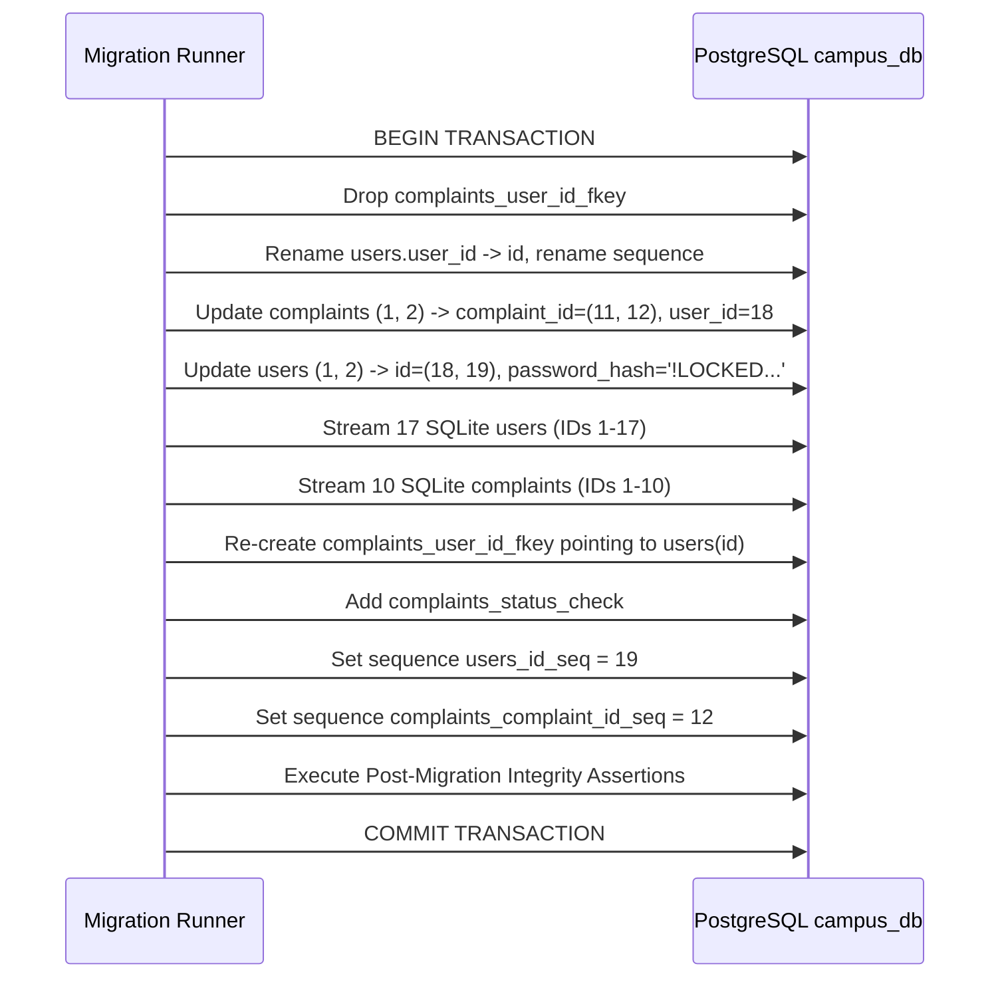

# POSTGRESQL MIGRATION PLAN — APPROVAL CANDIDATE
## CampusCare SQLite to PostgreSQL (`campus_db`) Production Migration Specification

**Document Version:** 4.0.0 (Approval Candidate)  
**Date:** 2026-10-10  
**Status:** **STRICTLY PLAN ONLY — NO CODE, DATABASE, OR CONFIGURATION CHANGES APPLIED**  
**Target Operational Database:** PostgreSQL `campus_db` (`localhost:5432`)  
**Verified Pre-Migration Backup Archive:** [`backups/backup_20261010_232229/`](file:///c:/Users/lenovo/Downloads/CampusCare_Frontend_Starter%20%285%29/CampusCare/backups/backup_20261010_232229)  

---

## 1. Classification of Knowledge & Epistemology

All facts, assumptions, and proposed actions in this document are strictly classified to prevent speculative drift:

- **`[VERIFIED FACT]`**: Ground-truth facts directly verified through read-only inspection of source code, catalog tables (`pg_constraint`, `information_schema.sequences`), or database files.
- **`[ASSUMPTION / UNVERIFIED]`**: Conditions that depend on runtime execution or testing in an isolated staging environment.
- **`[PROPOSED ACTION]`**: Architecture changes, SQL statements, and migration tasks designed for execution only upon explicit user approval.

---

## 2. PostgreSQL Connection-Layer Architecture & Route Design

### 2.1 Audit of Existing Route Database Consumption
- `[VERIFIED FACT]`: All FastAPI route handlers in `backend/routes/` (`auth.py`, `complaints.py`, `staff.py`, `admin.py`) currently follow this pattern:
  ```python
  connection = get_connection()
  cursor = connection.cursor()
  try:
      cursor.execute(...)
      row = cursor.fetchone() # Accesses fields as dictionary: row["id"], row["password_hash"]
      connection.commit()
  finally:
      connection.close()
  ```
- `[VERIFIED FACT]`: In SQLite, `connection.row_factory = sqlite3.Row` produces dictionary-accessible rows.
- `[VERIFIED FACT]`: In raw `psycopg2`, calling `connection.cursor()` produces tuple-based rows unless `cursor_factory=RealDictCursor` is specified. Furthermore, calling `connection.close()` on a raw pooled connection closes the underlying TCP socket instead of returning it to the pool.

### 2.2 Complete Refactored `backend/database.py` Specification
- `[PROPOSED ACTION]`: Replace `backend/database.py` with an enterprise-grade connection pool implementation supporting both context manager usage and backward-compatible connection wrapper usage:

```python
import os
from pathlib import Path
from contextlib import contextmanager
from dotenv import load_dotenv
import psycopg2
from psycopg2.pool import ThreadedConnectionPool
from psycopg2.extras import RealDictCursor, RealDictRow

BASE_DIR = Path(__file__).resolve().parent.parent
load_dotenv(BASE_DIR / ".env")

POSTGRES_HOST = os.getenv("POSTGRES_HOST", "localhost")
POSTGRES_PORT = int(os.getenv("POSTGRES_PORT", "5432"))
POSTGRES_DB = os.getenv("POSTGRES_DB", "campus_db")
POSTGRES_USER = os.getenv("POSTGRES_USER", "postgres")
POSTGRES_PASSWORD = os.getenv("POSTGRES_PASSWORD")

_pool: ThreadedConnectionPool | None = None

def init_pool(minconn: int = 1, maxconn: int = 20) -> None:
    """Initializes the PostgreSQL connection pool on application startup."""
    global _pool
    if _pool is None or _pool.closed:
        _pool = ThreadedConnectionPool(
            minconn=minconn,
            maxconn=maxconn,
            host=POSTGRES_HOST,
            port=POSTGRES_PORT,
            database=POSTGRES_DB,
            user=POSTGRES_USER,
            password=POSTGRES_PASSWORD
        )

def close_pool() -> None:
    """Closes all connections in the pool on application shutdown."""
    global _pool
    if _pool is not None and not _pool.closed:
        _pool.closeall()
        _pool = None

class PooledConnectionWrapper:
    """
    Transparent connection wrapper ensuring that .cursor() produces a RealDictCursor,
    and .close() returns the connection to the ThreadedConnectionPool instead of
    closing the underlying socket.
    """
    def __init__(self, raw_conn, pool: ThreadedConnectionPool):
        self._conn = raw_conn
        self._pool = pool
        self._closed = False

    def cursor(self):
        return self._conn.cursor(cursor_factory=RealDictCursor)

    def commit(self):
        self._conn.commit()

    def rollback(self):
        self._conn.rollback()

    def close(self):
        if not self._closed:
            self._pool.putconn(self._conn)
            self._closed = True

    def __enter__(self):
        return self

    def __exit__(self, exc_type, exc_val, exc_tb):
        if exc_type:
            self.rollback()
        else:
            self.commit()
        self.close()

def get_connection() -> PooledConnectionWrapper:
    """
    Backward-compatible connection factory for existing routes.
    Checks out a connection from the pool and wraps it.
    Calling connection.close() returns it safely to the pool.
    """
    if _pool is None or _pool.closed:
        init_pool()
    raw_conn = _pool.getconn()
    return PooledConnectionWrapper(raw_conn, _pool)

@contextmanager
def get_db_cursor():
    """Context manager for direct cursor checkout with automatic commit/rollback."""
    conn = get_connection()
    cursor = conn.cursor()
    try:
        yield cursor
        conn.commit()
    except Exception:
        conn.rollback()
        raise
    finally:
        cursor.close()
        conn.close()
```

### 2.3 Pool Lifecycle Integration in FastAPI (`backend/main.py`)
- `[PROPOSED ACTION]`: Add startup and shutdown lifecycle handlers to `backend/main.py`:
  ```python
  from database import init_pool, close_pool

  @app.on_event("startup")
  def on_startup():
      init_pool()

  @app.on_event("shutdown")
  def on_shutdown():
      close_pool()
  ```

---

## 3. Unified Final PostgreSQL Schema & Constraints Specification

### 3.1 Final Schema Definition (Post-Migration State)
- `[PROPOSED ACTION]`: The finalized target schema in `campus_db` will have the following exact columns and constraints:

#### Table: `public.users`
```sql
CREATE TABLE public.users (
    id INTEGER NOT NULL DEFAULT nextval('public.users_id_seq'::regclass),
    name VARCHAR(255) NOT NULL,
    email VARCHAR(255) NOT NULL,
    password_hash TEXT NOT NULL,
    role VARCHAR(50) NOT NULL DEFAULT 'student',
    created_at TIMESTAMP WITHOUT TIME ZONE NOT NULL DEFAULT CURRENT_TIMESTAMP,
    CONSTRAINT users_pkey PRIMARY KEY (id),
    CONSTRAINT users_email_key UNIQUE (email),
    CONSTRAINT users_role_check CHECK (role IN ('student', 'faculty', 'staff', 'admin'))
);
```

#### Table: `public.complaints`
```sql
CREATE TABLE public.complaints (
    complaint_id INTEGER NOT NULL DEFAULT nextval('public.complaints_complaint_id_seq'::regclass),
    user_id INTEGER NOT NULL,
    student_name VARCHAR(255) NOT NULL,
    email VARCHAR(255) NOT NULL,
    title VARCHAR(255) NULL,
    category VARCHAR(100) NOT NULL,
    location VARCHAR(255) NULL,
    description TEXT NOT NULL,
    priority VARCHAR(50) NOT NULL DEFAULT 'Medium',
    status VARCHAR(50) NOT NULL DEFAULT 'Pending',
    assigned_staff VARCHAR(255) NULL,
    created_at TIMESTAMP WITHOUT TIME ZONE NOT NULL DEFAULT CURRENT_TIMESTAMP,
    updated_at TIMESTAMP WITHOUT TIME ZONE NOT NULL DEFAULT CURRENT_TIMESTAMP,
    CONSTRAINT complaints_pkey PRIMARY KEY (complaint_id),
    CONSTRAINT complaints_user_id_fkey FOREIGN KEY (user_id) REFERENCES public.users(id) ON DELETE CASCADE,
    CONSTRAINT complaints_status_check CHECK (status IN ('Pending', 'In Progress', 'Resolved', 'Submitted'))
);
```

### 3.2 Two-Stage Constraint Application Strategy
- `[VERIFIED FACT]`: You cannot add a `NOT NULL` constraint to an existing table if existing rows have `NULL` values.
- `[PROPOSED ACTION]`: Apply constraints in two distinct phases:
  1. **Phase 1 (Pre-Transfer Structural Preparation):**
     - Add new columns as nullable (`password_hash TEXT`, `created_at TIMESTAMP`, etc.).
     - Drop non-deferrable `complaints_user_id_fkey` to allow re-keying.
  2. **Phase 2 (Post-Transfer Constraint Enforcement & Validation):**
     - Validate that all `users.password_hash` values are non-null.
     - Execute: `ALTER TABLE users ALTER COLUMN password_hash SET NOT NULL;`
     - Execute: `ALTER TABLE users ALTER COLUMN created_at SET NOT NULL;`
     - Execute: `ALTER TABLE complaints ALTER COLUMN student_name SET NOT NULL;`
     - Execute: `ALTER TABLE complaints ALTER COLUMN email SET NOT NULL;`
     - Execute: `ALTER TABLE complaints ALTER COLUMN priority SET NOT NULL;`
     - Execute: `ALTER TABLE complaints ALTER COLUMN status SET NOT NULL;`
     - Re-add: `ALTER TABLE complaints ADD CONSTRAINT complaints_user_id_fkey FOREIGN KEY (user_id) REFERENCES users(id) ON DELETE CASCADE;`
     - Add: `ALTER TABLE complaints ADD CONSTRAINT complaints_status_check CHECK (status IN ('Pending', 'In Progress', 'Resolved', 'Submitted'));`

---

## 4. Password Security & Legacy Credential Locking

### 4.1 SQLite Password Hashes Preservation
- `[VERIFIED FACT]`: The 17 SQLite user accounts contain valid Argon2 password hashes (`$argon2id$v=19$m=65536,t=3,p=4$...`).
- `[PROPOSED ACTION]`: All 17 hashes will be streamed 1:1 into PostgreSQL without re-hashing or modification, ensuring existing users (e.g. `student@test.com`, `admin@campuscare.com`) can log in with their current passwords immediately after migration.

### 4.2 Legacy Account Locking
- `[VERIFIED FACT]`: Existing `campus_db.users` records (`John Doe` [id=18] and `Jane Smith` [id=19]) currently have no password hash column.
- `[PROPOSED ACTION]`: During data transfer, populate their password hashes with:
  ```
  password_hash = '!LOCKED_LEGACY_RESET_REQUIRED_2026'
  ```
- `[VERIFIED FACT]`: In [`backend/routes/auth.py:129-144`](file:///c:/Users/lenovo/Downloads/CampusCare_Frontend_Starter%20%285%29/CampusCare/backend/routes/auth.py#L129-L144), `pwdlib.PasswordHash.recommended().verify(entered_password, stored_hash)` raises `UnknownHashError` when encountering the `!LOCKED` prefix.
- `[VERIFIED FACT]`: The existing route code explicitly wraps verification in `try...except Exception: valid_password = False`, converting this safely to HTTP 401 Unauthorized without 500 crashes.
- `[PROPOSED ACTION]`: Post-migration assertion query:
  ```sql
  SELECT count(*) FROM users WHERE password_hash IS NULL; -- Must equal 0
  ```

---

## 5. Foreign Key Deferrability & Safe Re-keying Sequence

### 5.1 Constraint Catalog Facts
- `[VERIFIED FACT]`: Catalog query on `campus_db`:
  ```sql
  SELECT condeferrable, condeferred FROM pg_constraint WHERE conname = 'complaints_user_id_fkey';
  ```
  Returns `condeferrable = False`, `condeferred = False`.
- `[VERIFIED FACT]`: Attempting to renumber `users.user_id = 1` to `18` while `complaints.user_id = 1` exists fails with a foreign key violation.
- `[VERIFIED FACT]`: In PostgreSQL, `ALTER TABLE ... DROP CONSTRAINT` and `ADD CONSTRAINT` are fully transactional.

### 5.2 Pre-Rekeying Assertion Gate
- `[PROPOSED ACTION]`: Before any ID modification, the migration runner will assert:
  1. `SELECT count(*) FROM users;` in `campus_db` equals **exactly 2**.
  2. `SELECT count(*) FROM complaints;` in `campus_db` equals **exactly 2**.
  3. `SELECT user_id, email FROM users ORDER BY user_id;` returns `(1, 'john@campus.edu')` and `(2, 'jane.smith@campus.edu')`.
  4. Target IDs `18` and `19` in `users` are unassigned.
  5. Target IDs `11` and `12` in `complaints` are unassigned.
  6. Source SQLite row counts equal **exactly 17 users** and **10 complaints**.
- If any assertion fails, the script will immediately abort and issue a `ROLLBACK`.

### 5.3 Deterministic Re-keying Execution Flow


---

## 6. Sequence Mechanics & ID Generation Proof

### 6.1 Users Sequence (`users_id_seq`)
- `[VERIFIED FACT]`: Catalog inspection shows sequence `public.users_user_id_seq` has `increment = 1`.
- `[PROPOSED ACTION]`: After column rename, rename sequence to `public.users_id_seq` and execute:
  ```sql
  SELECT setval('public.users_id_seq', 19, true);
  ```
- **Proof:** `is_called = true` dictates that the subsequent call to `nextval('users_id_seq')` by `POST /api/auth/register` evaluates to $19 + 1 = 20$.
- **The next registered user receives ID `20`.**

### 6.2 Complaints Sequence (`complaints_complaint_id_seq`)
- `[VERIFIED FACT]`: Sequence `public.complaints_complaint_id_seq` has `increment = 1`.
- `[PROPOSED ACTION]`: Execute:
  ```sql
  SELECT setval('public.complaints_complaint_id_seq', 12, true);
  ```
- **Proof:** `is_called = true` dictates that `nextval('complaints_complaint_id_seq')` evaluates to $12 + 1 = 13$.
- **The next submitted complaint receives ID `13` (rendered as `#CC-13`).**

---

## 7. Nullable Legacy Fields Compatibility (Zero Invention)

### 7.1 Field Nullability Contract
- `[PROPOSED ACTION]`:
  - `title`: Defined as `VARCHAR(255) NULL`. Legacy complaints `11` and `12` store `NULL`.
  - `location`: Defined as `VARCHAR(255) NULL`. Legacy complaints `11` and `12` store `NULL`.
  - `student_name`: Populated from user link (`'John Doe'`).
  - `email`: Populated from user link (`'john@campus.edu'`).
  - `priority`: Set to `'Unassigned'`.
  - `updated_at`: Set equal to `created_at` (`2026-09-16 23:24:38`).
  - `status`: Preserved as `'Submitted'`.

### 7.2 Compatibility Verification
- `[VERIFIED FACT]`: New complaint submissions via [`backend/routes/complaints.py:42-50`](file:///c:/Users/lenovo/Downloads/CampusCare_Frontend_Starter%20%285%29/CampusCare/backend/routes/complaints.py#L42-L50) require `title: str` and `location: str` through Pydantic. New submissions cannot be null.
- `[VERIFIED FACT]`: Frontend rendering in [`frontend/js/complaints.js:525`](file:///c:/Users/lenovo/Downloads/CampusCare_Frontend_Starter%20%285%29/CampusCare/frontend/js/complaints.js#L525) uses `value ?? ""` in `escapeHTML()`. `null` renders safely as empty string without console errors.
- `[VERIFIED FACT]`: Analytics service aggregates `COUNT(*)`, status, and category without reading titles or locations.

---

## 8. Preservation of Books & Vector Embeddings

### 8.1 Verification of Existing Vector Assets
- `[VERIFIED FACT]`: `campus_db.public.books` contains **5 rows** with 128-dimensional vector embeddings (`pg_typeof(embedding) = vector`) and sequence `books_book_id_seq` at `5`.
- `[VERIFIED FACT]`: `pgvector_code.public.complaint_embeddings` contains **2 rows** in an independent database.
- `[PROPOSED ACTION]`: The migration runner never references or alters `public.books` or `pgvector_code`.

### 8.2 Before & After Assertion Queries
- `[PROPOSED ACTION]`: Execute pre- and post-migration validation:
  ```sql
  SELECT count(*) FROM public.books; -- Must equal 5
  SELECT count(*) FROM public.books WHERE embedding IS NOT NULL; -- Must equal 5
  ```

---

## 9. Empirical Backup Verification: Test Restore Specification

### 9.1 Test Restore Procedure (Preflight Requirement)
- `[PROPOSED ACTION]`: To empirically prove the backup dump [`backups/backup_20261010_232229/postgres/campus_db.dump`](file:///c:/Users/lenovo/Downloads/CampusCare_Frontend_Starter%20%285%29/CampusCare/backups/backup_20261010_232229/postgres/campus_db.dump) can be restored (beyond TOC listing), execute a sandboxed test restore into a temporary database prior to migration:
  ```powershell
  # 1. Assert temporary database does not exist
  python -c "import psycopg2, os; from dotenv import load_dotenv; load_dotenv('.env'); conn=psycopg2.connect(host=os.getenv('POSTGRES_HOST'), port=os.getenv('POSTGRES_PORT'), database='postgres', user=os.getenv('POSTGRES_USER'), password=os.getenv('POSTGRES_PASSWORD')); cur=conn.cursor(); cur.execute(\"SELECT 1 FROM pg_database WHERE datname='campus_db_restore_test';\"); assert len(cur.fetchall()) == 0, 'Database already exists!'; cur.close(); conn.close();"

  # 2. Create sandboxed database
  python -c "import psycopg2, os; from dotenv import load_dotenv; load_dotenv('.env'); conn=psycopg2.connect(host=os.getenv('POSTGRES_HOST'), port=os.getenv('POSTGRES_PORT'), database='postgres', user=os.getenv('POSTGRES_USER'), password=os.getenv('POSTGRES_PASSWORD')); conn.autocommit=True; conn.cursor().execute('CREATE DATABASE campus_db_restore_test;'); conn.close();"

  # 3. Restore dump into sandboxed database
  & "C:\Program Files\PostgreSQL\18\bin\pg_restore.exe" -h localhost -p 5432 -U postgres -d campus_db_restore_test "backups\backup_20261010_232229\postgres\campus_db.dump"

  # 4. Assert restored row counts
  python -c "import psycopg2, os; from dotenv import load_dotenv; load_dotenv('.env'); conn=psycopg2.connect(host=os.getenv('POSTGRES_HOST'), port=os.getenv('POSTGRES_PORT'), database='campus_db_restore_test', user=os.getenv('POSTGRES_USER'), password=os.getenv('POSTGRES_PASSWORD')); cur=conn.cursor(); cur.execute('SELECT count(*) FROM users; SELECT count(*) FROM complaints; SELECT count(*) FROM books;'); u=cur.fetchone()[0]; cur.nextset(); c=cur.fetchone()[0]; cur.nextset(); b=cur.fetchone()[0]; print(f'Restored test: users={u}, complaints={c}, books={b}'); assert (u, c, b) == (2, 2, 5), 'Restored counts mismatch!'; cur.close(); conn.close();"

  # 5. Drop sandboxed database
  python -c "import psycopg2, os; from dotenv import load_dotenv; load_dotenv('.env'); conn=psycopg2.connect(host=os.getenv('POSTGRES_HOST'), port=os.getenv('POSTGRES_PORT'), database='postgres', user=os.getenv('POSTGRES_USER'), password=os.getenv('POSTGRES_PASSWORD')); conn.autocommit=True; conn.cursor().execute('DROP DATABASE campus_db_restore_test;'); conn.close();"
  ```

---

## 10. Code Backup Gap Analysis & Preflight Code Snapshot

### 10.1 Backup Audit Findings
- `[VERIFIED FACT]`: `backups/backup_20261010_232229/config/` currently contains:
  - `.env.backup`
  - `database.py`
  - `config.py`
  - `create_staff.py`
  - `backend_venv_pip_freeze.txt`
- `[VERIFIED FACT]`: The 4 route files (`auth.py`, `complaints.py`, `staff.py`, `admin.py`) and `analytics_service/app.py` were **NOT** captured in `backup_20261010_232229/config/`.
- `[PROPOSED ACTION]`: **Mandatory Preflight Action (Not yet performed):** As the very first execution step upon approval, create:
  `backups/backup_20261010_232229/code_snapshot/`
  and copy all 5 missing files before modifying any lines of code.

---

## 11. Transactional Migration Sequence & Post-Migration Integrity Queries

### 11.1 Execution Pipeline
1. **Preflight Phase:**
   - Execute test restore into `campus_db_restore_test` and drop it.
   - Create `code_snapshot/` backup for `auth.py`, `complaints.py`, `staff.py`, `admin.py`, `app.py`.
2. **Database Migration Phase:**
   - Execute `scripts/migrate_sqlite_to_postgres.py` within an explicit transaction.
   - Assert pre-rekeying source and target state.
   - Execute DDL, data transfer, sequence updates, and constraint additions.
   - Run Post-Migration Integrity Assertions (Sec. 11.2).
   - Commit transaction.
3. **Application Cutover Phase:**
   - Deploy refactored `backend/database.py`.
   - Update placeholders and `RETURNING` clauses in `routes/*.py` and `create_staff.py`.
   - Update `analytics_service/app.py` for PostgreSQL.
   - Update `.env` to `POSTGRES_DB=campus_db`.
   - Restart services.

### 11.2 Post-Migration Integrity Assertion Queries
```sql
-- 1. Total row count assertion
SELECT count(*) FROM users;       -- Must equal 19
SELECT count(*) FROM complaints;  -- Must equal 12
SELECT count(*) FROM books;       -- Must equal 5

-- 2. Duplicate email check
SELECT email, count(*) FROM users GROUP BY email HAVING count(*) > 1; -- Must return 0 rows

-- 3. Null password hash check
SELECT count(*) FROM users WHERE password_hash IS NULL; -- Must equal 0

-- 4. Missing required complaint fields check
SELECT count(*) FROM complaints 
WHERE student_name IS NULL OR email IS NULL OR category IS NULL 
   OR description IS NULL OR priority IS NULL OR status IS NULL 
   OR created_at IS NULL OR updated_at IS NULL; -- Must equal 0

-- 5. Orphan complaints referential check
SELECT c.complaint_id, c.user_id 
FROM complaints c 
LEFT JOIN users u ON c.user_id = u.id 
WHERE u.id IS NULL; -- Must return 0 rows

-- 6. Unexpected status check
SELECT DISTINCT status FROM complaints 
WHERE status NOT IN ('Pending', 'In Progress', 'Resolved', 'Submitted'); -- Must return 0 rows

-- 7. Sequence alignment check
SELECT last_value, is_called FROM users_id_seq;               -- last_value=19, is_called=true
SELECT last_value, is_called FROM complaints_complaint_id_seq; -- last_value=12, is_called=true
```

---

## 12. End-to-End Acceptance Test Matrix

| ID | Test Scenario | Execution Trigger | Expected Assertion | Verification Mechanism |
| :--- | :--- | :--- | :--- | :--- |
| **AT-01** | Database Counts | SQL Query | `users=19`, `complaints=12`, `books=5` | Direct PostgreSQL query |
| **AT-02** | Student Login | `POST /api/auth/login` (`student@test.com`) | 200 OK, JWT payload `id=2` | HTTP client / browser |
| **AT-03** | Admin Login | `POST /api/auth/login` (`admin@campuscare.com`) | 200 OK, JWT payload `id=13` | HTTP client / browser |
| **AT-04** | Locked Legacy Login | `POST /api/auth/login` (`john@campus.edu`) | 401 Unauthorized (`Invalid email or password`) | HTTP client |
| **AT-05** | Student Dashboard List | `GET /api/complaints` (student dhriti `id=8`) | 200 OK, returns complaints `#CC-10`, `#CC-9`, `#CC-8`, `#CC-7`, `#CC-4` | Student portal UI |
| **AT-06** | Create New Complaint | `POST /api/complaints` | 200 OK, created complaint ID is **`13`** (`#CC-13`) | Complaint form UI |
| **AT-07** | pgAdmin Visibility | Query `SELECT * FROM complaints WHERE complaint_id = 13` | Complaint 13 appears in pgAdmin immediately | pgAdmin query tool |
| **AT-08** | Staff Status Update | `PUT /api/staff/complaints/13/status` (`In Progress`) | 200 OK, database status updates, badge changes to `In Progress` | Staff dashboard UI |
| **AT-09** | Books Table Access | SQL Query | `count=5`, vectors intact | Direct PostgreSQL query |
| **AT-10** | Analytics Parity | `GET /analytics/summary` | Stats aggregate live records from `campus_db` | Analytics summary UI |

---

## 13. Stop Notice & Approval Checkpoint

- **STRICT SAFETY COMPLIANCE:** Zero application code files, configurations, database schemas, or database records have been modified.
- **APPROVAL REQUIRED:** Do not proceed with Preflight Step 1 or database migration until this document is formally approved.
